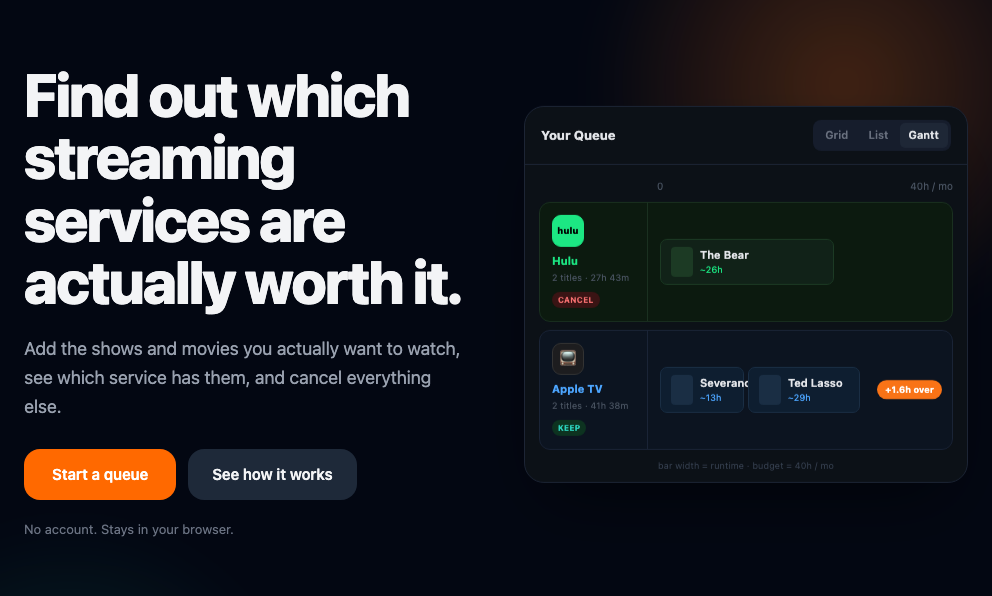
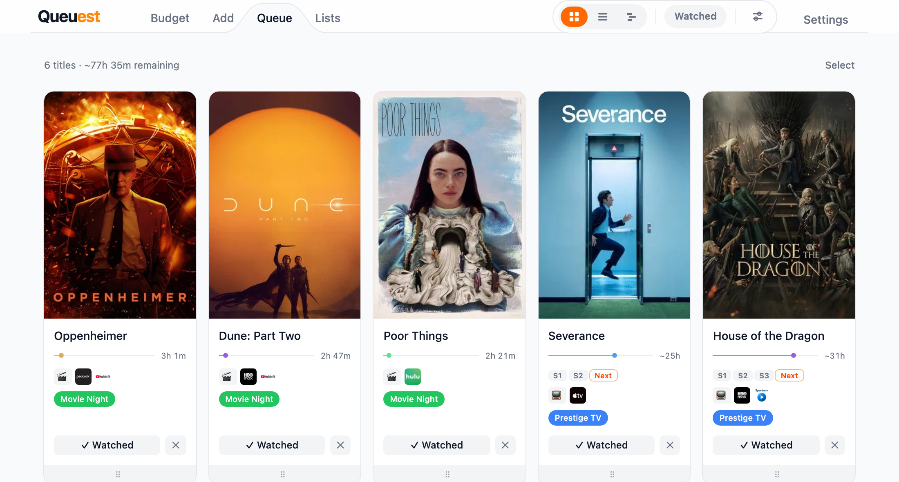
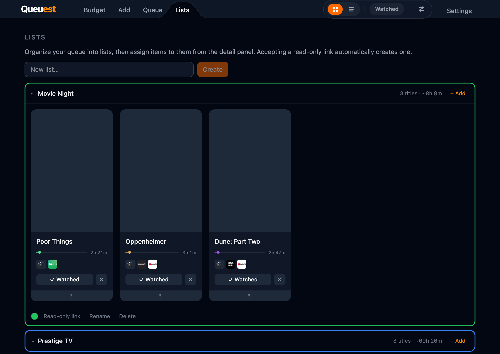
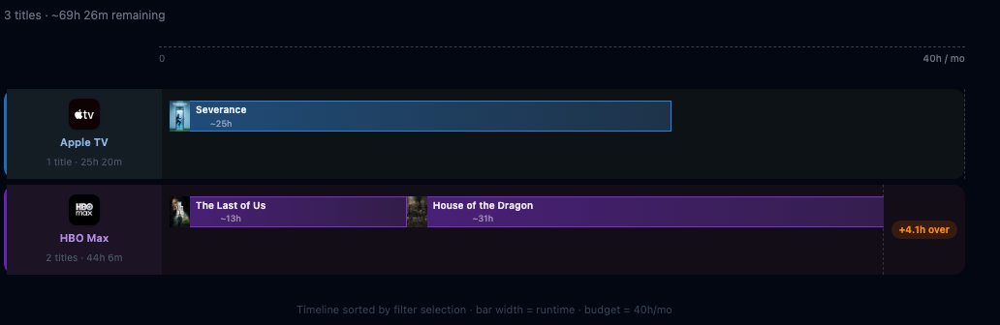
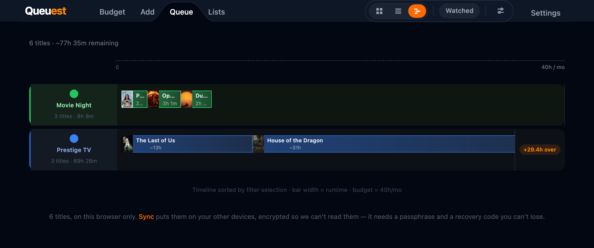
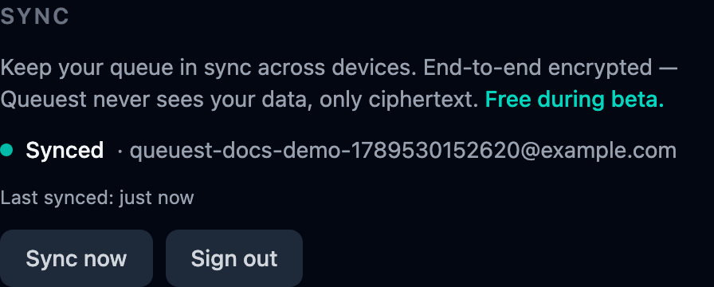

# Queuest

**Find out which streaming services are actually worth it.**

Queuest lets you build a watch queue, see which services carry each title, and estimate whether your backlog fits inside a single month of a given subscription. Stop auto-renewing things you're not watching.

---

## Showcase

**Landing page** — hero with interactive demo, service-aware queue filters, and how-it-works callout:



**Queue view** — Grid, List, and Gantt visualizations with provider swimlanes, runtime sparklines, and per-season progress tracking. Filter by subscribed services, watched status, and sort order. Light mode, with colour-coded list badges on each card:



**Lists** — organise your queue into colour-coded lists, each with its own running total:



**Gantt view** — grouped by provider by default, to show whether each subscription is worth keeping:



Switch the axis to group by list instead:



**Sync** — an optional account that keeps your queue encrypted end-to-end across devices:



---

## How it works

### 1. Build your queue
Search for movies and TV shows by name. Queuest pulls metadata from TMDB — poster, runtime, cast, genres, and which streaming services carry the title in the US (via JustWatch data). Tap any result to open a detail panel with the full picture before you add it. Add anything you want to watch to your queue.

### 2. See your subscription value
The **Gantt view** groups your queue by provider. Each bar's width represents watch time relative to your monthly viewing budget (configurable on the Budget page). If a provider's lane fits inside one bar-width, one month is all you need.

The **Suggest** tab ranks providers by total remaining watch time across your unwatched titles — useful for deciding what to subscribe to first. Checking off seasons reduces a show's contribution automatically.

### 3. Your data, your device
Everything is stored locally in your browser's IndexedDB. No account is required and no one is tracked — the whole app works signed-out (the two aggregate counters that do exist are spelled out under [Data & Privacy](#data--privacy)). It also works offline: once you've opened Queuest on a device, your queue, lists, and budget load with no connection at all (searching for new titles and syncing are the parts that need one, and say so). Use **Settings → Export Watchlist** to save a passphrase-encrypted `.queuest` file you can restore on any device. The backup includes your full queue, theme, budget, sort and view preferences, queue name, and list colors — a complete restore of everything local. Shared lists aren't included, since they never touch local storage — see below.

If you want the same queue on more than one device, **Settings → Sync** adds an optional account. Your queue is encrypted on your device before it's sent, under a key derived from a passphrase that never leaves your browser — so the server stores ciphertext it has no way to read.

### 4. Watch something together
**Lists** are for organising solo — but any list can become a **shared list**: an ongoing, two-way collection two or more people add to, watch, and track together, each seeing who added what and who's already watched it. Turn a personal list into one from the Lists page; invite by link or QR code. Both people need a Queuest account for this — changes sync on open and after each edit, end-to-end encrypted, so the server never sees the titles either side adds. The owner can remove a title from the list without it affecting anyone else's copy.

Can't agree on what to watch? Everyone can **rank their top 5 picks**, and Queuest aggregates them into a live group ranking — sort the list by Rank to see it in that order. If someone doesn't want an account, a **read-only link** shares a one-way, disposable snapshot of a list instead — no sign-in for either side, just a link that stops working after 30 days.

---

## Features

### The core idea

- 📊 **Gantt view** — one lane per service, bar width = remaining watch time against your monthly budget. If a lane fits inside one bar-width, one month of that subscription clears it. Lanes can group by service or by list.
- ⏱ **Viewing budget** — set hrs/week × weeks/month on the Budget page; every runtime in the app is framed against it.
- 🏆 **Suggest** — services ranked by total remaining watch time in your queue, so you know what to subscribe to next.
- 🔔 **Cancellation alerts** — a nudge when you've nearly cleared everything queued on a service.

### Sync and privacy

- 🔐 **End-to-end encrypted sync** — opt in and your queue follows you across devices. Encrypted client-side under a passphrase-derived key that never reaches the server; the server stores only ciphertext it cannot read. Includes a printed recovery code, because a forgotten passphrase is otherwise unrecoverable by design.
- 🔒 **Encrypted export / import** — AES-GCM + PBKDF2 via Web Crypto. Restores queue, preferences, view settings, and list colors completely. Shared lists aren't included — see below.

### Shared lists

- 👥 **Turn any list into a shared one** — an ongoing, two-way collection other people add to, watch, and track alongside you, each seeing who added what and who's already watched it. Each collaborator gets their own keypair; the list's own encryption key is wrapped individually per member, so the server only ever holds ciphertext no single party controls. Invite by link or QR code — the key travels in the URL fragment, never in a request the server logs. A small badge flags what's changed since you last looked. Removing a member rotates the key and re-encrypts the list in one step, so a removed member's access is actually revoked, not just hidden. The owner can also remove individual titles without leaving the list. Done with a list? The owner can delete it, and every member keeps its titles as a plain list of their own, along with their own watched and media-server marks. A member can leave on their own the same way.
- 🏆 **Ranked-choice voting** — everyone can rank up to 5 titles per shared list; picks are aggregated into a live group ranking by Borda count (5 points for a 1st choice down to 1 for 5th), shown next to your own editable ballot. Sort the list by Rank to see it in the group's order.
- 🔗 **Read-only links** — the account-free option: a disposable, one-way snapshot of a single list as a short URL, viewable and importable by anyone, no sign-in on either side. The decryption key lives only in the URL fragment. Links expire after 30 days.
- 🔍 **Link previews that show the actual list** — pasting an invite link into a chat app previews the real list name and who sent it, instead of generic branding.

### Organising the queue

- 🏷️ **Lists** — group titles into named, colour-coded lists (date night, with the kids, horror October). A title can be in several lists at once, and each list keeps its own order and runtime total. Accepting a read-only link automatically creates a list from it. Select multiple titles at once from the queue to assign, clear, mark watched, or remove them in bulk.
- 📋 **Grid, List, and Gantt views** with sort (A–Z, runtime, date added, watched, and a manual **Rank** you set by dragging) and optional grouping by list.
- ✋ **Drag and drop** — every card has a drag handle. Drag to reorder, or drop a card on the action bar that appears to move it to the top or bottom, or copy it into another list. On a shared list, the same bar copies a title into your own queue or edits your ranked picks.
- 🧭 **Queue dock** — the main filter surface: view switcher, inclusive Watched toggle, and sort/service/list filters.
- 📀 **On my media server** — check a box in any title's detail panel to mark it as already on your own media server, with a badge on its card. On a shared list, everyone sees the badge when any member has the title on their server, and the detail panel says whose. Optionally, connect a Jellyfin server and Queuest marks the titles it has for you: see [Connecting Jellyfin over Tailscale](docs/jellyfin-tailscale.md).
- 📝 **Notes** — add a note to any title. A shared list has one note per title, which only the list's owner can edit.
- ✅ **Watch tracking** — mark titles done; season-level progress (with episode counts) shrinks bar widths automatically. On a shared list, each collaborator's own watch mark is tracked independently.

### Finding and adding titles

- 🔍 **Search** movies and TV (TMDB) by title, actor, or director, with live suggestions as you type and a detail panel showing cast, providers, seasons, and release dates before you add.
- 📥 **Import** an existing watchlist from a Letterboxd or IMDb CSV (uploaded file or IMDb export link), or paste a list of titles from anywhere.
- 📺 **Streaming providers** per title (JustWatch / US), with bundle filtering and Disney+ inference (see below). Rent/Buy indicator when a title isn't on subscription, and Kanopy/Hoopla library links when it isn't streaming at all.
- 📅 **Upcoming release dates** — theatrical windows, estimated streaming dates, and next-season/next-episode dates; mid-season episodes distinguished from premieres.
- 🎬 **Detail panel** — poster lightbox, a wide backdrop image on desktop, full overview, cast, genres, providers, per-season progress, and IMDb links for the title, its director, and each cast member.

### Everything else

- 🚪 **Guided onboarding** for first-time visitors: one setup screen for your weekly viewing hours, the services you pay for, and a first title, plus a swipe / <kbd>Alt</kbd>+←→ tab-switching tip. Already have an account? Sign in from the landing page or the Import section and your queue downloads straight onto the new device.
- 📱 **Installable and offline** — add Queuest to your home screen like an app. Once it's been opened on a device, your queue, lists, and budget work with no connection.
- 🌙 **Dark / light mode**, persisted in preferences and backup file.
- 🔄 **Refresh data** — re-fetch streaming providers, cast, release dates, and season info for every queued title in one click (**Settings → Refresh Data**).
- 💬 **In-app feedback** — files a GitHub issue directly from Settings.

---

## Stack

| Layer | Technology |
|---|---|
| Framework | [SvelteKit 2](https://kit.svelte.dev) + [Svelte 5](https://svelte.dev) (runes) |
| Styling | [Tailwind CSS v4](https://tailwindcss.com) (Vite plugin, class-based dark mode) |
| Storage | [IndexedDB](https://developer.mozilla.org/en-US/docs/Web/API/IndexedDB_API) client-side; [Cloudflare D1](https://developers.cloudflare.com/d1/) + KV server-side for opt-in sync (ciphertext only) |
| Crypto | [Web Crypto API](https://developer.mozilla.org/en-US/docs/Web/API/Web_Crypto_API) — AES-GCM encryption, PBKDF2 key derivation, RSA-OAEP for per-member wrapped keys on shared lists |
| Data | [TMDB API](https://developer.themoviedb.org) — search, metadata, JustWatch provider data |
| Hosting | [Cloudflare Pages](https://pages.cloudflare.com) |
| Deployment | [@sveltejs/adapter-cloudflare](https://kit.svelte.dev/docs/adapter-cloudflare) |

---

## Development

```bash
npm install
npm run dev
```

You'll need a [TMDB API key](https://developer.themoviedb.org/docs/getting-started). Copy `.env.example` to `.env.local` and fill it in — this is what `npm run dev` reads:

```
TMDB_API_KEY=your_key_here
```

To enable in-app feedback (creates GitHub issues from Settings), add a fine-grained GitHub PAT with **Issues: Read & write** on this repo:

```
GITHUB_TOKEN=your_token_here
```

For link previews (Open Graph images) to render, set the site's public origin:

```
PUBLIC_ORIGIN=https://your-domain.example
```

Sync, sign-in, and shared lists need the local D1 database. Apply the migrations once, and again whenever a new one lands in `migrations/`:

```bash
npm run db:migrate:local
```

### Checks and tests

```bash
npm run check      # svelte-check + TypeScript
npm run lint       # ESLint + Prettier
npm test           # Vitest unit tests
npm run test:e2e   # Playwright end-to-end tests (run db:migrate:local first)
```

CI runs lint, type checks, and unit tests on every pull request. The end-to-end suite runs on demand from the Actions tab (**E2E (manual)**).

### Build & preview (Cloudflare)

```bash
npm run build
npm run preview   # uses wrangler pages dev
```

`npm run preview` runs through `wrangler`, which reads `.dev.vars` instead of `.env.local`. Copy `.env.example` to `.dev.vars` as well if you want a working TMDB key in preview mode.

---

## Data & Privacy

- **No account required, and none by default.** Everything works signed-out. No tracking cookies, no user or device identifiers, and nothing you add, search for, or name is ever part of what's measured.
- **Two things are measured, in aggregate, and neither is tied to a person.**
  - *Page loads.* Cloudflare Web Analytics counts which pages are loaded (by path — never the query string or `#fragment`), how quickly, and roughly where from (country, browser, device type). It uses no cookies or `localStorage` and doesn't fingerprint visitors.
  - *Sync failure counts.* Only if you turn on sync: when a sync fails in one of a handful of specific ways, the app sends just the name of the failure (for example `sync_409_exhausted`) and the server adds one to that day's count for it. The count is all that's stored — no account, device, or item comes with it.
- **Your watch data lives in your browser's IndexedDB.** It leaves your device only if you export it, create a read-only link, turn on sync, or share a list with someone — all four encrypt on your device first.
- **Sync is opt-in and end-to-end encrypted.** Turning it on creates an account (email + passphrase). Your queue is encrypted client-side under a key derived from your passphrase, which is never sent to the server — the server only ever stores ciphertext it cannot read. Shared lists build on the same account and the same guarantee, extended to multiple people. See [Sync and privacy](#sync-and-privacy) and [Shared lists](#shared-lists).
- **The optional Jellyfin library check talks only to your own server.** If you connect one under **Settings → Media Server**, your browser asks it which movies and shows it has, and nothing about your queue is sent to it. The server address and token are saved on the device and, if you use sync, in your encrypted sync data, so Queuest's servers never see them in readable form. They're never included in a `.queuest` export. On a shared list, the other members can see which titles are on your server. See [Connecting Jellyfin over Tailscale](docs/jellyfin-tailscale.md).
- Provider data is sourced from TMDB/JustWatch and reflects US availability only. It can lag real-world changes by a few days.
- This product uses the TMDB API but is not endorsed or certified by TMDB.

### A note on Disney+ data

Disney+ removed their catalogue from JustWatch, so TMDB's watch/providers API returns no Disney+ entries for the US. Queuest works around this by inferring Disney+ availability from first-party TMDB metadata that is still present — the show's network (Disney+) for TV, and the production company (Lucasfilm, Marvel Studios, Pixar, Walt Disney Pictures, Walt Disney Animation) for films. This correctly attributes titles like Star Wars, the MCU, and Loki to Disney+ rather than showing them as unavailable or mislabelled as Hulu. FX/Hulu originals like The Bear are unaffected. Use **Settings → Refresh Data** if anything looks wrong after a streaming rights change.

---

## Known limitations

- Provider data is US-only (JustWatch regional restriction via TMDB)
- Bundle-only availability (e.g. Hulu + Disney+ bundle) is filtered where detected; Disney+ data is inferred rather than sourced directly — see [#5](https://github.com/zenfinity/queuest/issues/5)
- Importing watchlists from other sources (Plex, additional Trakt-style feeds) is still open — see [#4](https://github.com/zenfinity/queuest/issues/4). Letterboxd and IMDb CSVs and pasted lists are already supported via **Add → Import**.
- Shared lists require an account on both sides — that's the tradeoff for multi-person editing under end-to-end encryption; it isn't push/real-time, it syncs on open and after each edit. The account-free option is a read-only link, which is one-way and doesn't stay in sync with future changes.

---

## License

AGPL 3.0
